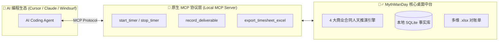
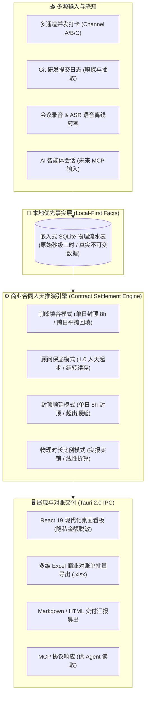

# 🧙‍♂️ 人天神话 (MythManDay)

[](https://github.com/ljl8086/mythmanday/actions/workflows/ci.yml)
[](https://github.com/ljl8086/mythmanday/releases)
[](https://github.com/ljl8086/mythmanday/stargazers)
[](LICENSE)
[](https://www.rust-lang.org/)
[](https://v2.tauri.app/)
[](https://github.com/ljl8086/mythmanday/releases)
[](CONTRIBUTING.md)

**中文说明** | [**English Documentation**](README_EN.md)

> **“在 AI 编程时代，向落后的软件项目增加人手只会让它更落后；  
> 但用传统的打卡方式记录工作时间，只会惩罚你的高效率。”**  
> —— 敬软件工程经典《人月神话》与所有被工时折磨的现代开发者

**专为独立开发者、技术顾问与外包团队打造的「商业对账神器」。**  
**终结月底痛苦手搓 Excel 的噩梦，让每一次代码编写、会议扯皮与并行投入，都能合法合规地变成无可辩驳的结算人天。**


---

## 🤯 你是否每个月底都在经历这种「工时地狱」？

如果你接私活、做咨询顾问，或者带外包团队，你一定经历过以下极其抓狂的场景：

### 1. 痛苦手搓 Excel：月底集体失忆与拼凑假账
- **现状**：客户催着要对账单才肯走付款流程。坐在电脑前两眼抹黑，全靠翻微信记录、日历、Git 提交考古；
- **折磨**：一边按计算器一边在 Excel 里手动凑数：*“哎呀，这天写了 12 小时超标了，那天下雨没干活只有 2 小时，周末加的班算不算？”* 手动把加班工时挪来挪去；公式经常算崩、日期格式混乱，被对方财务无情打回重做！

### 2. 开会扯皮 3 小时，一行代码没写，月底被砍人天
- **现状**：下午跟客户线上连线扯皮 3 小时：梳理需求边界、架构方案评审、现场排障，聊得口干舌燥、脑细胞死了一大半，但 **Git 仓库里是 0 提交**；
- **被坑**：月底报工时写“需求沟通 4 小时”，客户一句*“打个电话聊两句要算半天钱？水分太大，砍掉 2 小时吧”*。开会时没精力记笔记，会后懒得整理，缺乏白纸黑字的证据，只能吃哑巴亏！

### 3. AI 时代效率悖论：越快，赚得越少？
- **现状**：凭借多年的架构底子和 AI 辅助，原本需要 5 天的活被你 1 天优雅搞定。如果按传统计时打卡只有 8 小时，难道你只能收 1 天的钱？**你的高效率不仅没获得溢价，反而成了降薪的借口！**

### 4. 商业底牌不敢上云（NDA 泄密风险）
- **现状**：你的时薪单价、客户名称、流水明细、私活数量，凭什么上传给第三方 SaaS？给客户开会的录音包含核心商业机密和系统漏洞，上传到公有云转写极易违反保密协议 (NDA)。

---

## 💡 MythManDay 如何降维打击？

| 对比维度 | 肉身手工编 Excel | 传统打卡 SaaS (Toggl / Clockify) | **人天神话 (MythManDay)** |
| :--- | :--- | :--- | :--- |
| **平时记录** | 全靠脑子硬记，忘得一干二净 | 单任务串行，频繁切换极其繁琐 | **多通道随手开**，后台并行无感记录 |
| **会议与沟通** | 0 代码提交，月底心虚被砍工时 | 只能记个时间，无实际内容支撑 | **开会即录音 + 本地 AI 自动提炼纪要**，自动注入交付凭证 |
| **AI 交付成果** | 手动敲假大空的字句拼凑日报 | 无法读取本地 Git 与开发上下文 | **Git Commit + Code Diff + 录音** 全量 AI 结构化提炼 |
| **合同人天换算** | 拿计算器手动算保底、削峰填谷凑数 | 只支持简单的（工时 × 时薪），算不了复杂合同 | **内置 4 大合同人天引擎**（削峰填谷、顾问保底、顺延结转） |
| **月底出对账单** | 花半天调格式、填单元格、修公式 | 导出的 CSV/PDF 不符合国内财务报销规范 | **一键生成精美多维 `.xlsx`**（按月分 Sheet，财务秒过） |
| **数据隐私** | 本地文件，但易损坏丢失 | 必须上传公有云，商业单价与客户全暴露 | **100% 本地 SQLite**，支持一键金额隐身模式 |

---

## ✨ 核心杀手锏功能

### 📊 1. 现代化多维 Excel 商业对账单批量导出（财务杀手）
- **一键成表**：告别手工调格式。支持多选项目、多选月份一键导出为标准的 `.xlsx` 文件；
- **按月自动分工作表 (Sheet)**：每个项目独立成册，项目内按月份自动拆分独立 Sheet，带有优雅的商业抬头、自动文本换行与纯净求和公式；
- **自由脱敏开关**：可自由勾选「是否在 Excel 中导出金额与单价列」，不需要金额时自适应调整为严谨的 7 列工时人天对账单，直接发给客户经理和财务！

### 🎙️ 2. 开会即存证：本地安全录音与语音存证（堵住客户的嘴）
- **开会即打卡**：开会时随手点一下录音，计时通道自动启动，会议时长无缝沉淀为合法工时；
- **录音自动压缩归档**：录音结束自动调用底层驱动重采样为 16kHz 单声道并压缩为高保真 MP3 归档，节省磁盘空间；
- **本地优先离线识别**：支持本地 Whisper 离线语音识别，音频绝不上云，彻底规避商业 NDA 泄密风险；
- **白纸黑字证据链**：月底客户质疑？白纸黑字会议议题一拉，当场签字付款！

### 🤖 3. 全链路 AI 智能赋能（把琐碎过程提炼为商业凭证）
- **AI 结构化会议纪要提取**：
  从冗长拉扯的录音转写文本中，自动过滤重复口癖与无意义寒暄，精准提炼出【讨论议题】、【核心决议】与【待办事项 (Action Items)】，**直接注入当天的流水描述中**；
- **Git Commit + Diff 智能合成日报**：
  自动读取关联本地 Git 仓库的代码提交历史与差异变更，调用大模型一键将零碎晦涩的提交转换为向客户/管理层交付的专业工作成果报告；
- **本地化隐私承诺**：兼容本地私有化大模型或自选 OpenAI 兼容 API，商业敏感信息不出域。

### ⚙️ 4. 四大商业合同人天推演引擎（捍卫劳动价值）
> ⚠️ **事实与规则严格分层**：系统永久保留原始秒级物理打卡记录（不可篡改的事实数据），合同人天仅作为商业推演规则计算，全流程可审计。
- **合同合规削峰填谷模式**：单日按 8 小时封顶；超出的工时自动平摊回填到历史不足 8 小时的日历工作日或顺延到未来，周末不计工时，完美契合标准外包合同；
- **顾问保底 8 小时模式**：当天只要有有效咨询投入，按商业协议以 1.0 人天起步保底结算，超出部分顺延结转；
- **封顶顺延模式**：单日按 8 小时封顶计价，溢出部分自动结转至后续结算日；
- **实际物理工时比例模式**：按实际投入时长等比折算人天（实际时长 / 8.0），实报实销；
- **阶梯舍入控制**：支持向上取整 (Ceil)、四舍五入 (Round)、截断 (Floor)，最小颗粒度支持 0.5、1.0、0.25 天。

### 🔄 5. 多通道独立并行打卡与离线扣除
- 真实工作流从来不是串行的：后台跑项目 A 的编译与自动化测试，前台跟项目 B 的客户沟通，脑子里还在想自研项目 C；
- 支持为多个项目同时建立独立时间通道，并行记录各项目真实投入，告别频繁切换的脑残操作，支持摸鱼/离线离开时长一键扣减。

### 🕵️ 6. 100% 本地优先与全局金额隐身
- **数据绝对私密**：所有客户、单价、流水与录音 100% 留存在本地 SQLite，杜绝任何未经授权的远程上报；
- **全局金额一键隐身**：顶栏一键切换「金额已隐藏」，在咖啡厅办公、屏幕共享或给同事演示时，全局流水与看板自动脱敏，守住你的商业底牌。

---

## 🗺️ 重磅未来规划：原生 MCP (Model Context Protocol) 改造计划

> **人天神话 (MythManDay) 正在进化为 AI Agent 时代开发者人天中台的基础设施。**

随着以 Cursor、Claude Desktop、Windsurf 为代表的 AI 编程智能体全面普及，我们正在启动**原生的 MCP Server** 改造计划，彻底打通「AI 编程生产力」与「商业价值结算」的最后一公里：



- 🔌 **Agent 编码会话自动打卡**：
  当你在 Cursor / Claude 中派发任务时，Agent 通过 MCP 工具自动启动对应项目的计时通道，任务完成自动停止，彻底实现“零人工干预”工时沉淀；
- 📊 **代码成果自动入库对账**：
  Agent 编写代码、修复缺陷并跑通测试后，通过 MCP 工具直接将本次重构的工作摘要写入当天的工时交付凭证；
- 💬 **对话式一键对账出表**：
  无需打开界面，直接在 IDE 对话框中向 AI 下令：“*帮我导出项目 A 上个月削峰填谷后的对账单*”，瞬时生成挑不出毛病的 `.xlsx` 文件！

---

## 🏗️ 架构与数据流设计

MythManDay 严格遵循**「原始物理流水不可篡改」**与**「商业规则分层推演」**的设计哲学：



---

## 🚀 快速上手与运行

### 1. 运行核心与数据库单元测试
```bash
cargo test -p myth-core -p myth-db -p myth-git -p myth-ai
```

### 2. 本地开发与调试
```bash
# 1. 进入前端目录启动 Vite 开发热更新服务器
cd frontend && pnpm install && pnpm dev --port 1420

# 2. 另起终端运行 Tauri 桌面端
cargo run --bin mythmanday-app
```

### 3. 安装与打包

#### 🐧 Linux PPA 官方源一键安装
```bash
# 1. 添加软件源
sudo add-apt-repository ppa:ljl8086/ppa
sudo apt update

# 2. 安装并启动
sudo apt install mythmanday
mythmanday
```

#### 🛠️ Linux 源码本机一键安装 (无需 root)
```bash
chmod +x ./install.sh && ./install.sh
```

#### 📦 Linux 制作 .deb 安装包 (生成于 dist 目录)
```bash
chmod +x ./scripts/build-deb.sh && ./scripts/build-deb.sh
```

#### 🪟 Windows 编译与打包
```powershell
cd frontend && pnpm build && cd ..
cargo build --release --bin mythmanday-app
# 生成安装程序: cd frontend && pnpm tauri build
```

#### 🍏 macOS 编译与打包
```bash
cd frontend && pnpm build && cd ..
cargo build --release --bin mythmanday-app
# 生成 DMG 镜像: cd frontend && pnpm tauri build --bundles dmg,app
```

---

## 🛠️ 技术栈与依赖

| 组件 / 框架 | 官方说明 | 技术说明 |
| :--- | :--- | :--- |
| **Rust 1.80+** | [www.rust-lang.org](https://www.rust-lang.org/) | 高性能、类型安全的底层多通道计时与商业对账结算引擎 |
| **Tauri 2.0** | [v2.tauri.app](https://v2.tauri.app/) | 轻量级、高安全性的跨平台桌面原生运行时与进程通信 |
| **React 19** | [react.dev](https://react.dev/) | 现代化声明式响应式前端用户交互界面 |
| **Tailwind CSS** | [tailwindcss.com](https://tailwindcss.com/) | 现代原子化商业界面排版与暗色侧边栏风格系统 |
| **SQLite (rusqlite)** | [www.sqlite.org](https://www.sqlite.org/) | 嵌入式本地优先持久化存储，保障数据绝对私密性 |

---

## 📈 Star History

[](https://star-history.com/#ljl8086/mythmanday&Date)

---

## 📜 著作权与开源许可

- **软件全称**：人天神话-开发者人天中台 [简称：MythManDay] v0.1.0 (Early Access)
- **版权所有**：Copyright (c) 2026 ljl8086 <ljl8086@126.com>. All Rights Reserved.
- **开源协议**：本项目基于 [MIT 许可证](LICENSE) 授权开源。
