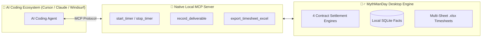
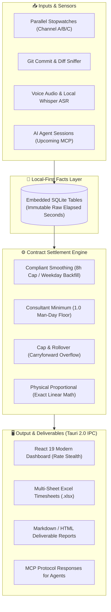

# 🧙‍♂️ MythManDay (The Mythical Man-Day)

[](https://github.com/ljl8086/mythmanday/actions/workflows/ci.yml)
[](https://github.com/ljl8086/mythmanday/releases)
[](https://github.com/ljl8086/mythmanday/stargazers)
[](LICENSE)
[](https://www.rust-lang.org/)
[](https://v2.tauri.app/)
[](https://github.com/ljl8086/mythmanday/releases)
[](CONTRIBUTING.md)

[**中文说明**](README.md) | **English**

> **“In the AI era, adding manpower to a late software project makes it later;  
> but tracking keystrokes with traditional punch-clocks only punishes your high efficiency.”**  
> —— In tribute to *The Mythical Man-Month* and every modern developer burdened by timesheets.

**The Commercial Timesheet & Billing Platform for Indie Hackers, Consultants, and Dev Studios.**  
**End the nightmare of monthly manual Excel spreadsheets. Turn every line of code, 3-hour client meeting, and parallel session into auditable, contract-compliant billable man-days.**


---

## 🤯 Are You Suffering from Monthly "Timesheet Hell"?

If you freelance, consult, or run a software development boutique, you know these frustrating moments:

### 1. Manual Excel Torture: Month-End Amnesia & Fabricated Entries
- **The Reality**: The client demands a detailed timesheet before releasing payment. Staring at an empty spreadsheet, you dig frantically through chat logs, calendars, and git commits just to remember what you did on the 10th.
- **The Agony**: Hand-tweaking hours with a calculator to make sure no day exceeds 8 hours, shifting overtime across weekdays, only to have broken formulas or formatting rejected by strict accounting departments.

### 2. The 3-Hour Meeting Trap: Zero Commits, Zero Proof
- **The Reality**: You spend half the day on a video call negotiating architecture boundaries, debugging client staging environments, and clarifying specs. You are mentally exhausted, but **your Git commit log is 100% blank**.
- **The Trap**: You bill "4 hours: Architecture meeting," and the client pushes back: *"Four hours just to chat? Cut that in half."* Without a recorded paper trail, you're forced to take the hit.

### 3. The AI Efficiency Paradox: The Faster You Deliver, The Less You Earn?
- **The Reality**: Using your senior architecture skills combined with AI, you build in 1 day what used to take 5 days. If you log 8 hours on a traditional timer, do you only bill for 1 day? **Your extreme efficiency earns you a pay cut instead of a premium!**

### 4. NDA & Commercial Secrecy on Public Cloud SaaS
- **The Reality**: Why should your hourly billing rates, client roster, and confidential meeting discussions be uploaded to third-party US-hosted SaaS tools like Toggl or Clockify?

---

## 💡 How MythManDay Destroys the Old Workflow

| Dimension | Manual Handcrafted Excel | Traditional Cloud SaaS (Toggl / Clockify) | **MythManDay** |
| :--- | :--- | :--- | :--- |
| **Tracking** | Forgotten, retrospective guesswork | Single-task serial timers; tedious switching | **Parallel multi-channel**, one-click effortless tracking |
| **Meetings & Audio** | 0 commit evidence; vulnerable to rate cuts | Plain time log; zero substantive proof | **Record on-the-fly + Local AI summary**, auto-linked to deliverables |
| **AI Deliverables** | Vague, hand-typed daily reports | No access to local git or dev context | **Git Commits + Code Diffs + Audio** full-pipeline structured extraction |
| **Contract Rules** | Manual calculator hacks for day minimums | Primitive math (hours × rate) without contract logic | **4 Built-in Contract Engines** (smoothing, consultant floor, rollover) |
| **Exporting Bills** | Hours spent reformatting broken sheets | Clunky CSVs/PDFs rejected by enterprise finance | **Instant multi-dimensional `.xlsx`** (auto monthly sheets, finance-ready) |
| **Data Privacy** | Local, but prone to corruption/loss | Forced cloud upload; rates & clients exposed | **100% Local SQLite**, one-click stealth mode for rates |

---

## ✨ Core Features

### 📊 1. Multi-Dimensional Excel Commercial Timesheet Export
- **One-Click Batch Export**: Select multiple projects and months to produce standardized, professional `.xlsx` workbooks.
- **Automatic Monthly Sheets**: Every project generates a clean workbook with separate monthly sheets, styled business headers, automatic line wrapping, and pure numerical formulas.
- **Configurable Privacy Columns**: Toggle whether billing rates and amounts are exported. Omitting financial columns cleanly reflows the table into a compliant 7-column timesheet.

### 🎙️ 2. Meeting Audio Evidence & Local Voice Capture
- **Meeting = Billable Time**: Start a voice memo to activate project tracking; meeting duration seamlessly solidifies into legitimate billable records.
- **Automated MP3 Archiving**: Cleanly resamples audio to 16kHz mono and compresses raw captures into lightweight MP3s upon session end.
- **Local-First Whisper ASR**: Transcribe speech locally without cloud leaks, adhering 100% to commercial Non-Disclosure Agreements (NDAs).

### 🤖 3. End-to-End AI-Assisted Deliverables
- **Structured Executive Meeting Summaries**:
  Cleans hallucinations and speech filler, extracting actionable **Discussion Topics**, **Architecture Decisions**, and **Action Items**, directly appended to the day's timesheet log.
- **Git Commit & Diff Synthesis**:
  Inspects local repository commits and code diffs over specified time windows, using LLMs to compile messy commit histories into polished client deliverable reports.
- **Local & Private LLM Friendly**: Connect seamlessly with local Ollama/vLLM endpoints or private OpenAI-compatible gateways.

### ⚙️ 4. Four Commercial Contract Settlement Engines
> ⚠️ **Strict Separation of Facts & Rules**: Raw elapsed physical seconds are stored immutably. Contract man-days are evaluated dynamically based on commercial agreements.
- **Contract Compliant Smoothing**: Caps billable time at 8h/day (1.0 man-day), backfilling deficit historical weekdays or rolling over into future working days (excluding weekends).
- **Consultant Minimum 8h Floor**: Any qualifying engagement on a calendar day bills as a minimum 1.0 man-day floor; surplus time rolls forward.
- **Cap & Rollover**: 8h daily cap, carrying forward overflow hours into subsequent billing cycles.
- **Physical Proportional**: Exact linear conversion (Elapsed Hours / 8.0) without smoothing.
- **Granular Stepped Rounding**: Supports Ceil, Round, and Floor steps (0.5d, 1.0d, 0.25d).

### 🔄 5. Multi-Channel Parallel Tracking & AFK Deduction
- Run Channel A (compiling/testing), Channel B (client communication), and Channel C (R&D) concurrently.
- One-click AFK idle time deduction ensures honest tracking.

### 🕵️ 6. 100% Local-First & Global Amount Stealth Mode
- **Zero Cloud Exposure**: All rates, logs, clients, and recordings stay securely inside your local SQLite database.
- **One-Click Stealth Mode**: Toggle hidden amounts in header to mask billing figures instantly during screen shares, client demos, or cafe work.

---

## 🗺️ Roadmap: Native Model Context Protocol (MCP) Support

> **MythManDay is evolving into the essential billing & timesheet infrastructure for AI Coding Agents.**

As autonomous AI development tools (Cursor, Claude Desktop, Windsurf) become the standard, we are introducing **Native Local MCP Server** capabilities:



- 🔌 **Autonomous Agent Tracking**:
  When you dispatch a task in Cursor or Claude, the agent automatically invokes `start_timer(project="client_a")` via MCP, stopping upon task completion.
- 📊 **Automatic Deliverable Injection**:
  Upon test verification, the agent pushes code summaries and resolved issues directly into the timesheet log.
- 💬 **Conversational Billing**:
  Ask your agent: *"Export last month's smoothed timesheet for Client B"*, and receive the finalized `.xlsx` workbook directly inside your chat window.

---

## 🏗️ Architecture & Data Flow



---

## 🚀 Quick Start

### 1. Run Unit Tests
```bash
cargo test -p myth-core -p myth-db -p myth-git -p myth-ai
```

### 2. Local Development
```bash
# 1. Start Vite development server
cd frontend && pnpm install && pnpm dev --port 1420

# 2. Launch Tauri desktop app in another terminal
cargo run --bin mythmanday-app
```

### 3. Installation & Distribution

#### 🐧 Ubuntu PPA Quick Install
```bash
sudo add-apt-repository ppa:ljl8086/ppa
sudo apt update
sudo apt install mythmanday
mythmanday
```

#### 🛠️ Linux One-Click Script (Non-Root)
```bash
chmod +x ./install.sh && ./install.sh
```

> 💡 **If MythManDay helps streamline your timesheet billing, please give us a ⭐ Star on GitHub! Your support keeps this project going.**

#### 📦 Build Debian / Ubuntu `.deb` Package
```bash
chmod +x ./scripts/build-deb.sh && ./scripts/build-deb.sh
```

#### 🪟 Windows Build
```powershell
cd frontend && pnpm build && cd ..
cargo build --release --bin mythmanday-app
```

#### 🍏 macOS Build
```bash
cd frontend && pnpm build && cd ..
cargo build --release --bin mythmanday-app
```

---

## 🛠️ Technology Stack

| Component | Official Reference | Role |
| :--- | :--- | :--- |
| **Rust 1.80+** | [www.rust-lang.org](https://www.rust-lang.org/) | Core parallel timing and contract billing engine |
| **Tauri 2.0** | [v2.tauri.app](https://v2.tauri.app/) | Secure, lightweight native cross-platform desktop runtime |
| **React 19** | [react.dev](https://react.dev/) | High-performance declarative user interface |
| **Tailwind CSS** | [tailwindcss.com](https://tailwindcss.com/) | Modern atomic styling with dark slate theme |
| **SQLite (rusqlite)** | [www.sqlite.org](https://www.sqlite.org/) | Embedded local-first storage safeguarding commercial privacy |

---

## 📈 Star History & Traffic Archive

[](https://star-history.com/#ljl8086/mythmanday&Date)

- [📊 View Full Repository Traffic & Clone History (Traffic Archive)](traffic-data/README.md)

---

## 📜 Intellectual Property & License

- **Software Name**: 人天神话-开发者人天中台 (MythManDay)
- **Copyright**: Copyright (c) 2026 ljl8086 <ljl8086@126.com>. All Rights Reserved.
- **License**: Released under the [MIT License](LICENSE).
